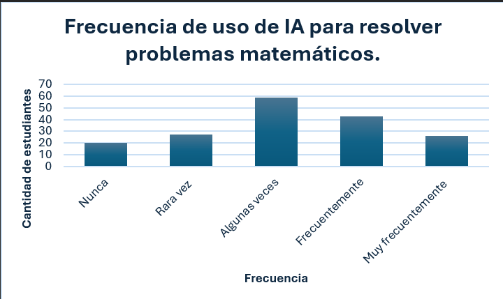
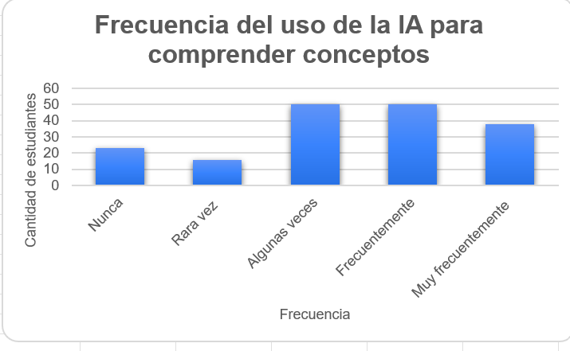

# uso-ia-matematicas
Este repositorio tendra como fin analizar una muestra de estudio en donde se pregunta sobre la frecuencia del uso de la IA en matemáticas.
# Uso de inteligencia artificial en el aprendizaje de las matemáticas

# Descripción del proyecto

Este proyecto presenta un análisis exploratorio del uso de herramientas de inteligencia artificial en el aprendizaje de las matemáticas. A partir de datos recopilados mediante una encuesta, se elaboraron visualizaciones para describir la frecuencia con la que los participantes utilizan estas herramientas con diferentes propósitos académicos.

Este es un proyecto inicial de análisis de datos que se ampliará progresivamente.

# Objetivo

Explorar los patrones de uso de la inteligencia artificial en el aprendizaje de las matemáticas mediante tablas de frecuencia, visualizaciones e interpretación descriptiva de los resultados.

# Variables analizadas

**Resolución de problemas matemáticos**

Describe la frecuencia con la que los participantes utilizan herramientas de inteligencia artificial para resolver ejercicios o problemas matemáticos.

**Comprensión de conceptos matemáticos**

Describe la frecuencia con la que los participantes utilizan herramientas de inteligencia artificial para comprender conceptos matemáticos que les resultan difíciles.

# Principales resultados

- **Resolución de problemas matemáticos:** la categoría más frecuente fue “Algunas veces”, con 59 respuestas de 177 (33,3 %).
- **Comprensión de conceptos matemáticos:** las categorías “Algunas veces” y “Frecuentemente” fueron las más seleccionadas, con 50 respuestas cada una (28,2 %).

Estos resultados permiten describir las respuestas de la muestra, pero no demuestran que la inteligencia artificial mejore o perjudique el aprendizaje de las matemáticas.

# Analisis descriptivo en comparacion a las dos variables
Los resultados muestran que la inteligencia artificial se utiliza para ambos propósitos, pero presenta una mayor frecuencia de uso para comprender conceptos matemáticos difíciles. Mientras que para resolver problemas la respuesta más común es «Algunas veces», para comprender conceptos se destaca también la categoría «Frecuentemente». Esto sugiere que, en esta muestra, la IA tiene una presencia importante como herramienta de apoyo a la comprensión matemática. No obstante, los resultados son descriptivos y no permiten afirmar que su uso mejore directamente el aprendizaje; para establecer esa relación sería necesario analizar otras variables y contar con evidencia adicional.

## Herramientas utilizadas

- Microsoft Excel.
- Tablas de frecuencia.
- Gráficos de columnas.
- Análisis descriptivo e interpretación de resultados.

## Visualizaciones

### 1. Frecuencia de uso de IA para resolver problemas matemáticos

### 2. Frecuencia de uso de IA para comprender conceptos matemáticos difíciles

## Alcance y próximos pasos

Este proyecto constituye una primera aproximación al análisis de datos educativos. Como trabajo futuro, se podrán explorar variables relacionadas con la autonomía del estudiante, la verificación de respuestas generadas por IA y otros aspectos del aprendizaje de las matemáticas.

## Nota metodológica

Los resultados presentados son descriptivos y corresponden a las respuestas recopiladas mediante una encuesta. Su interpretación depende de las características de la muestra y del instrumento utilizado. No se establecen relaciones causales ni se generalizan los resultados a toda la población estudiantil.
